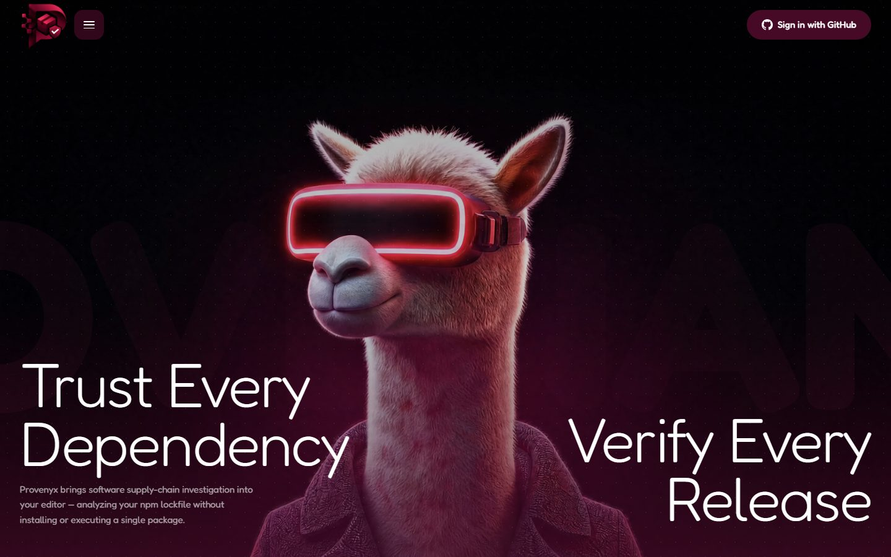
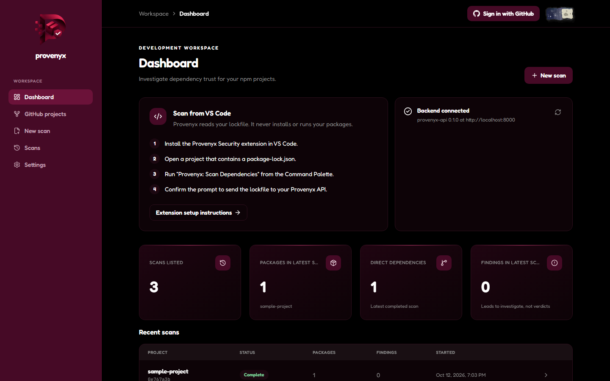
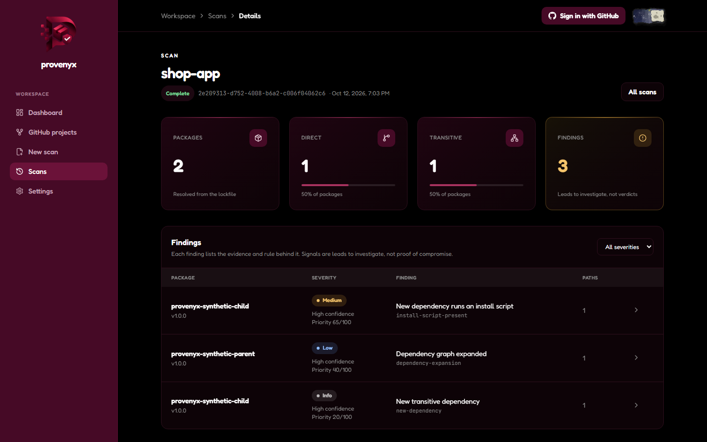
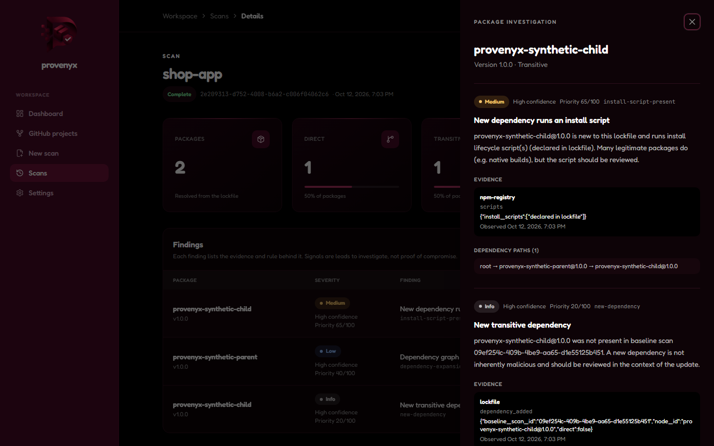
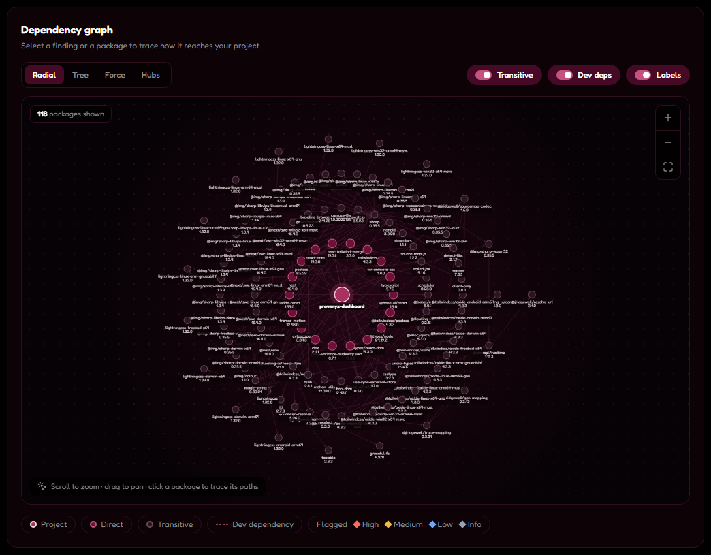
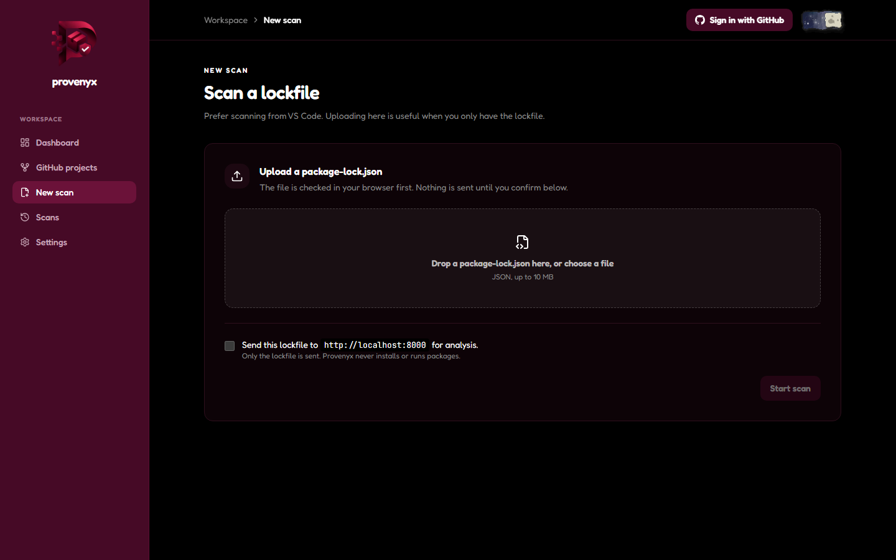

<div align="center">


# Provenyx Security

**Trust every dependency. Verify every release.**

Explainable software supply-chain security for npm projects, in your editor, your browser and your pull requests.

[](LICENSE)


[**Live dashboard**](https://provenyx.vercel.app) · [Screenshots](#screenshots) · [Getting started](#getting-started) · [Deployment](#deployment) · [Documentation](#documentation)

</div>



## Overview

Provenyx is a software supply-chain security tool for JavaScript and TypeScript projects that use npm. It reviews what changed in your dependencies, explains each finding with evidence, and checks npm releases against a blockchain registry of approved release manifests. It never installs or runs your packages.

It has three parts: a **VS Code extension** (the main product), a **web dashboard** for deeper investigation, and a **smart-contract registry** for approved releases. All three use one **FastAPI backend**.

---

## Contents

- [Overview](#overview)
- [Screenshots](#screenshots)
- [Why Provenyx](#why-provenyx)
- [How it works](#how-it-works)
- [Features](#features)
- [Detection rules](#detection-rules)
- [Pull request trust gate](#pull-request-trust-gate)
- [Release verification on the blockchain](#release-verification-on-the-blockchain)
- [Safety and privacy principles](#safety-and-privacy-principles)
- [How Provenyx compares](#how-provenyx-compares)
- [Architecture](#architecture)
- [Tech stack](#tech-stack)
- [Repository layout](#repository-layout)
- [Getting started](#getting-started)
- [Running the full demo](#running-the-full-demo)
- [Deployment](#deployment)
- [Testing](#testing)
- [API overview](#api-overview)
- [Configuration](#configuration)
- [Project status](#project-status)
- [Limitations and future work](#limitations-and-future-work)
- [Team](#team)
- [Documentation](#documentation)
- [License](#license)

---

## Screenshots

<table>
  <tr>
    <td width="50%"></td>
    <td width="50%"></td>
  </tr>
  <tr>
    <td align="center"><b>Dashboard</b><br/><sub>Backend status, latest-scan metrics and scan history</sub></td>
    <td align="center"><b>Scan findings</b><br/><sub>Severity, confidence and priority for every finding</sub></td>
  </tr>
  <tr>
    <td width="50%"></td>
    <td width="50%"></td>
  </tr>
  <tr>
    <td align="center"><b>Package investigation</b><br/><sub>The evidence, its source and the exact dependency path</sub></td>
    <td align="center"><b>Dependency graph</b><br/><sub>Radial, tree, force and hub layouts with path tracing</sub></td>
  </tr>
  <tr>
    <td width="50%"></td>
    <td width="50%"></td>
  </tr>
  <tr>
    <td align="center"><b>New scan</b><br/><sub>Validated in the browser; nothing is sent without consent</sub></td>
    <td></td>
  </tr>
</table>

<sub>Captured with the Playwright CLI from a local build, using the synthetic demo fixtures in <code>demo/fixtures/</code> and this repository's own <code>frontend/package-lock.json</code>.</sub>

---

## Why Provenyx

A modern JavaScript project pulls in hundreds of transitive dependencies. Supply-chain attacks rarely look like known vulnerabilities. Instead, a routine update quietly brings in a new package, widens the dependency tree, or ships a release minutes after the last one. Developers usually merge these lockfile changes without looking, because a lockfile diff is unreadable.

Provenyx answers three questions about every dependency update:

1. **What changed?** Which packages and dependency edges are new compared with the last scan of this project.
2. **How does it reach my app?** The exact dependency path from your project to each flagged package (the "blast radius").
3. **Is this the release we approved?** Whether a release's metadata matches a manifest that a trusted party anchored on-chain.

Every answer comes with its evidence, and Provenyx is explicit about what it does *not* know.

## How it works

```text
 package-lock.json                                              Hardhat chain
        │                                                     ┌────────────────┐
        ▼                                                     │ ReleaseRegistry│
 ┌───────────────┐   consent   ┌─────────────────────────┐   │ name@version → │
 │ VS Code       │────────────▶│ FastAPI backend         │   │ manifest hash  │
 │ extension     │  (lockfile  │ 1. parse lockfile v1-v3 │   └───────▲────────┘
 │ • find & check│   only)     │ 2. build dependency     │           │ read-only
 │   lockfile    │             │    graph (NetworkX)     │           │ eth_call
 │ • ask consent │◀────────────│ 3. fetch npm metadata   │───────────┘
 │ • show        │  findings   │ 4. diff vs. baseline    │
 │   findings    │             │ 5. run explainable rules│
 └──────┬────────┘             │ 6. store (SQLite)       │
        │ "Open in Dashboard"  └───────────▲─────────────┘
        ▼                                  │
 ┌──────────────────────────────────────────┴──┐
 │ Next.js dashboard: findings, evidence,      │
 │ dependency graph, release verification      │
 └─────────────────────────────────────────────┘
```

1. In VS Code you run **Provenyx: Scan Dependencies**. The extension finds `package-lock.json`, checks it locally, and asks for consent before sending anything. It names the destination URL, and only the lockfile is sent.
2. The backend stores a snapshot and analyses it in the background. It parses the lockfile, builds a dependency graph that keeps multiple installed versions distinct, and fetches public npm metadata with bounded concurrency, caching, timeouts and retries.
3. Every exact package version is checked against public OSV advisories. If the project has been scanned before, the new graph is also compared with the latest completed scan for suspicious changes.
4. The extension follows the scan to completion and lists the findings in the sidebar. Clicking a finding opens it in the dashboard.
5. In the dashboard you can explore the graph, read the evidence, and **verify a release** against the on-chain registry.

## Features

### VS Code extension

- **Provenyx: Scan Dependencies.** Finds `package-lock.json` (v1–v3), validates it locally (10 MB limit), asks for consent, submits it, and follows the scan to completion.
- **Findings sidebar.** Shows the project, backend connection, last scan status, and findings sorted by severity and priority. Tooltips include the explanation, confidence, priority and dependency path.
- **Provenyx: Open Dashboard.** Opens the dashboard, or the exact scan or finding when you click a sidebar item.
- **Provenyx: Check Backend Connection.**
- **Automatic lockfile watcher** (`provenyx.autoScanEnabled`, on by default). Creation or changes start one debounced scan flow, which still asks for consent before sending anything.
- Handles an offline backend, timeouts and missing lockfiles without crashing. No telemetry.

### Web dashboard

- **Dashboard.** Shows backend status, setup guidance, real scan history, and metrics from the latest completed scan.
- **New scan** (`/scan/new`). Upload a lockfile; it is validated in the browser, and you tick an explicit consent box that names the API URL.
- **GitHub sign-in and projects** (`/github`). Sign in with GitHub and scan a lockfile straight from one of your repositories, public or private. The token stays in an encrypted, HTTP-only cookie and is never stored.
- **Scan detail** (`/scans/[id]`):
  - live progress while the scan runs
  - metrics and analysis notes (what could not be determined)
  - a findings table with a severity filter
  - an interactive **dependency graph** (Cytoscape.js) with radial, tree, force and hub layouts, zoom, pan, node selection and path highlighting
- **Package panel.** Evidence, unknowns, dependency paths, npm registry metadata (licence, deprecation, integrity), install locations, and **release verification**.
- Designed for desktop and phone (no horizontal scrolling at 390 px), with accessible controls and honest empty, loading and error states.

### Backend

- Scans are persisted through SQLAlchemy: SQLite locally, PostgreSQL (for example Neon) in production, chosen by one connection string.
- Lockfile parser for v1, v2 and v3, including scoped names and nested `node_modules` paths.
- The dependency graph uses npm's nearest-ancestor resolution.
- npm registry client with caching and bounded concurrency. Metadata it cannot fetch is marked *unavailable*, never guessed.
- Scan comparison: added and removed packages, version changes, new dependency edges.
- Optional Gemini reranking of generated finding summaries, with deterministic fallback.
- Release verification endpoint (read-only JSON-RPC; no keys).

### Smart contract

- `ReleaseRegistry.sol` stores a manifest hash and a timestamp for each release. Records are write-once and only the owner can anchor.
- Deploy and anchor scripts for a local Hardhat chain.

## Detection rules

Known-vulnerability checks run on the first scan. Change-based rules require a **baseline**, meaning an earlier completed scan of the same project.

| Rule | Fires when | Severity | Confidence | Priority |
|---|---|---|---|---|
| `new-dependency` | A package is present now but was not in the baseline | info | high | 30 if direct, 20 if transitive |
| `dependency-expansion` | An existing package gained new dependency edges | low | high | 35 + 5 per new edge (max 60) |
| `unusual-release-timing` | An upgraded version was published within 1 hour of its predecessor (npm release times). **Experimental:** a fixed threshold, not each package's own release cadence | low | medium | 45 |
| `publisher-change` | npm identifies a different release-specific publisher for the upgraded version | medium | high | 60 |
| `known-vulnerability` | OSV matches the exact installed npm package and version | OSV-derived | high | 55–95 |
| `install-script-added` | An upgraded version runs an install lifecycle script (`preinstall`/`install`/`postinstall`) its predecessor did not | high | high | 85 |
| `install-script-present` | A newly added package runs an install lifecycle script | medium | high | 65 |
| `provenance-removed` | The previous version had an npm build provenance attestation and the upgrade does not | medium | medium | 70 |
| `deprecated-package` | npm marks a release a pull request adds or updates as deprecated (trust gate only) | low | high | 40 |

Severity (impact), confidence (how sure the rule is) and priority (0–100, for ordering) are independent. Every finding has at least one piece of evidence: its source (`lockfile`, `npm-registry`), the field, the value, and when it was observed. Findings are **leads to investigate, not proof of compromise**, and a normal upgrade is not flagged as high risk.

Install scripts come from npm registry metadata, falling back to the lockfile's own `hasInstallScript` flag when the registry has no record of a release.

Gemini reranking is optional and disabled by default. It receives only generated finding summaries, never lockfiles, dependency graphs or raw evidence. Both Gemini and deterministic scores remain visible; timeouts or invalid responses retain deterministic order.

## Pull request trust gate

The trust gate turns analysis into prevention: on every pull request that changes a `package-lock.json`, it compares the PR's lockfile with the base branch, examines **only the releases the PR adds or updates**, and posts an explainable report with a pass, warning or fail status check.

```text
❌ Dependency Trust Check: FAILED

✗ express 4.18.2 → 4.18.3
  ✓ No known vulnerabilities
  ✗ New postinstall script introduced
  ⚠ Publisher changed: alice → mallory
  ⚠ Build provenance missing (previous version had it)
  Blast radius: shop-app → express
```

Each changed release is checked for OSV advisories, install scripts, publisher changes, build provenance, deprecation, release timing, new dependencies and, when a chain is configured, its Provenyx release anchor. Registry metadata is fetched only for changed releases and their predecessors, so large lockfiles stay fast. No package code is downloaded or executed.

Use it in any repository:

```yaml
# .github/workflows/dependency-trust-gate.yml
on:
  pull_request:
    paths: ['**/package-lock.json']
permissions:
  contents: read
  pull-requests: write
jobs:
  trust-gate:
    runs-on: ubuntu-latest
    steps:
      - uses: actions/checkout@v4
      - uses: aad1tyaaaaa/DevKnights@main
        with:
          lockfile: package-lock.json   # repository-relative path
          fail-on: high                 # high | medium | low | never
```

A release fails when it has a finding at or above `fail-on`, or when it differs from its anchored release record; lower-severity findings produce a warning. A missing anchor is reported as an evidence gap, never a failure. The same check runs locally or in any CI:

```bash
cd backend
python -m app.gate --base base-lock.json --head ../package-lock.json --markdown report.md   # exit 1 = fail
```

…or over HTTP with `POST /api/gate`. This repository dogfoods it in [.github/workflows/dependency-trust-gate.yml](.github/workflows/dependency-trust-gate.yml).

## Release verification on the blockchain

npm's own provenance (Sigstore) records **who built** a package. Provenyx records **who approved it**: a trusted party, such as your team or an auditor, anchors the hash of a release's canonical manifest in a smart contract. Anyone can later check a release against that record without trusting the Provenyx server.

- **Canonical manifest (schema 1):** `{"integrity": <npm dist.integrity>, "name", "schema_version": 1, "version"}`, written as UTF-8 JSON with sorted keys and no whitespace.
- **Manifest hash:** `keccak256(manifest bytes)`. **Release id:** `keccak256(utf8("name@version"))`.
- The Python and TypeScript implementations (`backend/app/blockchain/manifest.py`, `contracts/scripts/manifest.ts`) are both tested against the same values.
- The backend only **reads** the chain (`eth_call`), and holds no private keys. Anchoring is a separate step in `contracts/` that only the registry owner can perform.

| Result | Meaning |
|---|---|
| `match` | The current metadata equals the approved record. This is **not** a verdict that the package is safe. |
| `mismatch` | The metadata differs from the approved record. Investigate before trusting the release. |
| `no_record` | Nothing has been anchored for this release. This is a gap in the evidence, **not** a risk signal. |
| `unavailable` | The chain or the metadata could not be reached, so nothing is concluded. |

The registry runs on a **local Hardhat development chain only**. No public network, wallet or cryptocurrency is involved. Trust is only as strong as the registry owner: a single key anchors records, and nothing is externally governed. A match proves consistency with what that owner approved, not that the release is harmless.

## Safety and privacy principles

- **Never executes scanned code.** No `npm install`, no lifecycle scripts, no package code. Lockfiles are treated as data. One test fixture even contains a fake install script to show that nothing runs it.
- **Never uploads without consent.** Each scan is confirmed, the destination URL is shown, and only `package-lock.json` is sent.
- **Never invents results.** No fake findings, metrics or risk scores. When metadata is missing, it is shown as unknown.
- **Limits AI disclosure.** Optional Gemini ranking receives generated finding summaries only and falls back to deterministic scores.
- **Interprets results honestly.** A missing blockchain record is not evidence of malice, and a matching hash is not proof of safety.
- **Hardened inputs.** Request bodies are capped at 10 MiB while they stream in, schemas are strict, error messages never echo your input, CORS is restricted, and package names and versions are validated.
- **No secrets and no telemetry.**

## How Provenyx compares

| Tool | Focus | How Provenyx differs |
|---|---|---|
| [Socket](https://socket.dev) | Scans package code for risky behaviour (install scripts, network/shell access, typosquats, maintainer changes); has a VS Code extension | Provenyx reviews **what changed between two scans** and shows the dependency path. Its detection is narrower (nine explainable rules); it complements Socket rather than replacing it. |
| Snyk, `npm audit` | Known vulnerabilities (CVEs) | Provenyx looks at the *behaviour* of updates, not CVE databases. |
| npm provenance / Sigstore | Proves which CI pipeline built a package | Provenyx anchors **who approved** a release, as an independently checkable record. |
| NpmGuard (ETHGlobal 2026) | Runs packages in a sandbox with AI-assisted review; gives a SAFE/DANGEROUS verdict | Provenyx never executes packages, and uses the chain for approved-release records rather than payments. |

**What sets it apart:** lockfile change review inside the editor, explainable evidence with dependency paths, and a ledger of team-approved releases that anyone can check.

## Architecture

| Component | Responsibilities |
|---|---|
| `extension/` | Finds and validates the lockfile, asks for consent, submits the scan, follows its status, shows the sidebar, links to the dashboard. |
| `backend/app/parsers/` | Lockfile parser (v1–v3) and npm registry client. |
| `backend/app/graph/` | Dependency graph builder (NetworkX) and scan comparison. |
| `backend/app/detection/` | Explainable detection rules. |
| `backend/app/blockchain/` | Canonical manifest, read-only registry client, release verifier, CLI. |
| `backend/app/models/` | Pydantic API schemas and SQLAlchemy persistence. |
| `frontend/` | Dashboard, upload, scan investigation, dependency graph, verification UI. |
| `contracts/` | `ReleaseRegistry.sol`, deploy and anchor scripts, reference TypeScript manifest. |

The monorepo deliberately does **not** use npm workspaces: each JavaScript package has its own `node_modules`, which keeps VSIX packaging, Next.js and Hardhat 3 (ESM) independent. Python dependencies live in `backend/requirements.txt`. More detail is in [docs/architecture.md](docs/architecture.md).

## Tech stack

| Area | Technologies |
|---|---|
| Extension | TypeScript, VS Code Extension API (TreeView), esbuild, `@vscode/vsce`, `@vscode/test-electron` |
| Backend | Python 3.11+, FastAPI, Pydantic, Uvicorn, SQLAlchemy (SQLite or PostgreSQL via psycopg), NetworkX, httpx, GitHub OAuth, optional Gemini ranking, pytest |
| Frontend | Next.js 16 (App Router), React 19, TypeScript, Tailwind CSS 4, shadcn/ui conventions, Framer Motion, Lucide icons, Cytoscape.js |
| Hosting | Vercel (dashboard), Render (API), Neon (PostgreSQL) |
| Blockchain | Solidity 0.8.28, Hardhat 3, viem, `node:test` |

## Repository layout

```text
.
├── extension/        VS Code extension (src/, test/ smoke tests, images/, README, CHANGELOG, LICENSE)
├── backend/          FastAPI service (app/{api,core,models,parsers,graph,detection,blockchain}, tests/)
├── frontend/         Next.js dashboard (app/, components/, lib/)
├── contracts/        Hardhat 3 workspace (contracts/, scripts/, test/)
├── demo/             sample-project/, synthetic fixtures/, anchors.demo.json
├── docs/             architecture, API contract, development, demo script, Marketplace checklist, images/
├── .vscode/          F5 launch config for the Extension Development Host
├── PROVENYX_END_TO_END_PHASES.md   plan, phases and ownership
├── progress.md                     what is done and verified
└── package.json                    convenience scripts (no workspaces)
```

## Getting started

### Prerequisites

Node.js 22.10 or later (24 recommended), npm, Python 3.11 or later, VS Code 1.90 or later, and Git. The first contract compile downloads the Solidity compiler, and the first extension test downloads a VS Code build.

### Install

```bash
npm run install:all                     # extension, frontend, contracts

cd backend
python -m venv .venv
# Windows (PowerShell): .venv\Scripts\Activate.ps1   Git Bash: source .venv/Scripts/activate   macOS/Linux: source .venv/bin/activate
pip install -r requirements.txt
```

### Run

From the repository root:

```bash
npm run dev:backend      # terminal 1: API on http://localhost:8000 (required by the extension)
npm run dev:frontend     # terminal 2: dashboard on http://localhost:3000
npm run dev:chain        # terminal 3 (optional, for release verification): local chain on :8545
```

If the extension's sidebar shows **Backend: Unreachable**, the API isn't running. Start it with `npm run dev:backend`, then click the Backend item to retry.

### Launch the extension

Open the repository root in VS Code and press **F5** (*Run Provenyx Extension*). A development window opens on `demo/sample-project`. Click the shield icon in the Activity Bar, or run `Ctrl+Shift+P` → **Provenyx: Scan Dependencies**.

### Package the extension

```bash
npm run package:extension               # → extension/provenyx-security-0.1.0.vsix
code --install-extension extension/provenyx-security-0.1.0.vsix
```

Full OS-specific instructions are in [docs/development.md](docs/development.md).

## Running the full demo

1. Start the API, the dashboard and the chain (see [Run](#run)).
2. Deploy the registry and anchor the demo records:

   ```bash
   npm --prefix contracts run deploy:local
   cp demo/anchors.demo.json contracts/anchors.json
   npm --prefix contracts run anchor:local
   ```

   `ms@2.1.3` is anchored with its real manifest hash, so it verifies as **match**. `ms@2.1.2` is anchored with a **deliberately altered** hash, so it verifies as **mismatch**.
3. Create findings: on `/scan/new`, upload `demo/fixtures/baseline-package-lock.json` and then `demo/fixtures/suspicious-update-package-lock.json`. Both are **synthetic** fixtures.
4. Scan `demo/sample-project` from VS Code. Open it in the dashboard, click `ms` in the graph, and press **Verify release**.

To anchor real releases, generate entries from live npm metadata:

```bash
cd backend && python -m app.blockchain.manifest ms@2.1.3 left-pad@1.3.0 > ../contracts/anchors.json
```

The presenter script and fallbacks are in [docs/demo-script.md](docs/demo-script.md).

## Deployment

The whole project runs online on free tiers:

| Part | Host | Configured by |
|---|---|---|
| Dashboard (`frontend/`) | Vercel | `frontend/next.config.mjs` proxies `/api/*` to the API so cookies stay first-party |
| API (`backend/`) | Render | [`render.yaml`](render.yaml) Blueprint: build, start command, health check and generated secrets |
| Database | Neon PostgreSQL | `PROVENYX_DATABASE_URL`, used exactly as Neon provides it |
| Sign-in | GitHub OAuth App | Callback `https://<your-dashboard>/api/github/auth/callback` |

The API start command is:

```bash
uvicorn app.main:app --host 0.0.0.0 --port $PORT --proxy-headers --forwarded-allow-ips '*'
```

Set the same `PROVENYX_API_KEY` on Render and Vercel. If your Render service URL is not `https://provenyx-api.onrender.com`, set `PROVENYX_API_PROXY_URL` on Vercel and redeploy. The step-by-step guide, including keep-alive pings for the free plan, is in [deploy.md](deploy.md).

## Testing

| Suite | Command | Covers |
|---|---|---|
| Backend (93 tests) | `cd backend && python -m pytest` | Health, scan API, parser, graph, comparison, detection rules, npm client, end to end, release verification and the shared test values. Each test uses its own temporary database and no real npm traffic. |
| Contracts (6 tests) | `npm run test:contracts` | Anchoring, records, access control, write-once, and the values shared with Python. |
| Extension smoke test | `npm --prefix extension run test:smoke` | Runs in a real VS Code instance: activation, commands, consent, scan → findings, backend offline, debounced watcher, and an empty workspace. Add `PROVENYX_SMOKE_REAL_API=http://127.0.0.1:8000` to also run a real scan. |
| Frontend | `npm run build:frontend` | Production build with full type checking. |

## API overview

| Endpoint | Purpose |
|---|---|
| `GET /health` | Connectivity |
| `POST /api/scans` | Submit a lockfile (202, analysis runs in the background) |
| `GET /api/scans` | Recent scans |
| `GET /api/scans/{id}` | Status, summary, warnings |
| `GET /api/scans/{id}/graph` | Nodes (with npm metadata) and edges |
| `GET /api/scans/{id}/findings` | Evidence-backed findings |
| `GET /api/scans/{id}/compare/{baseline_id}` | Diff between two scans |
| `POST /api/releases/verify` | `match`, `mismatch`, `no_record` or `unavailable` |
| `POST /api/gate` | Pull request trust gate: base vs. head lockfile → pass / warn / fail report |

The full schemas are in [docs/api-contract.md](docs/api-contract.md). Interactive docs are at `http://localhost:8000/docs`.

## Configuration

| Where | Setting | Default |
|---|---|---|
| VS Code | `provenyx.apiBaseUrl` | `http://localhost:8000` |
| VS Code | `provenyx.dashboardUrl` | `http://localhost:3000` |
| VS Code | `provenyx.autoScanEnabled` | `true` |
| VS Code | `provenyx.apiKey` | empty (local backend) |
| Backend (`backend/.env`) | `PROVENYX_API_KEY` (shared access key; unset = open, local only), `PROVENYX_SUBMISSION_RATE_LIMIT_PER_MINUTE` | unset, `30` |
| Backend (`backend/.env`) | `PROVENYX_CORS_ORIGINS`, `PROVENYX_MAX_SCAN_BYTES`, `PROVENYX_DATABASE_URL`, `PROVENYX_NPM_REGISTRY_*`, `PROVENYX_GITHUB_*`, `PROVENYX_REGISTRY_RPC_URL`, `PROVENYX_REGISTRY_ADDRESS` | See `backend/.env.example` |
| Frontend (`frontend/.env.local`) | `NEXT_PUBLIC_PROVENYX_API_URL`, `NEXT_PUBLIC_PROVENYX_REQUIRE_SIGN_IN` | `http://localhost:8000`, `true` |
| Frontend (Vercel) | `PROVENYX_API_KEY` (added server-side by `proxy.ts`), `PROVENYX_API_PROXY_URL` | unset, `https://provenyx-api.onrender.com` |

**Deploying beyond your machine:** scans are not owned by users yet, so anyone who can reach an open backend can list and read every scan. Set `PROVENYX_API_KEY` (and the matching dashboard and extension settings) before exposing it. This is one shared key, not per-user isolation; the deployed dashboard adds it on the server, so it never reaches browsers. Scan and trust-gate submissions are rate limited per client address.

## Project status

All eight phases are implemented and verified. Details are in [progress.md](progress.md) and [PROVENYX_END_TO_END_PHASES.md](PROVENYX_END_TO_END_PHASES.md).

| Phase | Scope | Status |
|---|---|---|
| 1 | Foundation: monorepo, API contract | ✅ |
| 2 | VS Code extension | ✅ |
| 3 | Real npm scanner (parser, graph, registry, persistence) | ✅ |
| 4 | Explainable risk detection | ✅ |
| 5 | Web dashboard | ✅ |
| 6 | Blockchain release verification | ✅ |
| 7 | Integration and testing | ✅ |
| 8 | Marketplace readiness and demo | ✅ Ready (publisher `Provenyx`); publishing needs the publisher's access token |

## Limitations and future work

- **Detection remains focused.** OSV advisories work without a baseline; the change-based rules compare against an earlier scan. Next candidates include maintainer-history analysis and typosquat detection.
- **The registry is minimal.** It has one owner, write-once records, and runs only on a local chain. Next: multi-signer approvals (for example 2 of N team members), revocation, and a public testnet.
- **Shared access, not per-user isolation.** The hosted API is protected by GitHub sign-in and one shared access key, but scans are not yet owned by individual users. Per-user scan ownership and privacy terms come before opening it to the public.
- **npm only.** pnpm, Yarn and other ecosystems are future work.
- **Known flaky test:** the extension smoke test occasionally fails on its first launch, before any test code runs. A rerun passes.

## Team

| Developer | Owns |
|---|---|
| **Aaditya** | VS Code extension, web dashboard, smart contract and verification UI, Marketplace and demo |
| **Omkar** | Lockfile scanner, dependency graph, npm registry client, detection rules, verification backend |

## Documentation

- [Architecture](docs/architecture.md)
- [API contract](docs/api-contract.md)
- [Development guide](docs/development.md)
- [Phase 1 advanced threat detection](docs/phase1-threat-detection.md)
- [Phase 2 AI intelligence and impact analysis](docs/phase2-ai-impact-analysis.md)
- [Free deployment guide (Vercel + Render + Neon)](deploy.md)
- [Demo script](docs/demo-script.md)
- [Marketplace checklist](docs/marketplace-checklist.md)
- [Contracts and release registry](contracts/README.md)
- [Extension README (Marketplace listing)](extension/README.md)

## License

[MIT](LICENSE) © 2026 The Provenyx contributors
